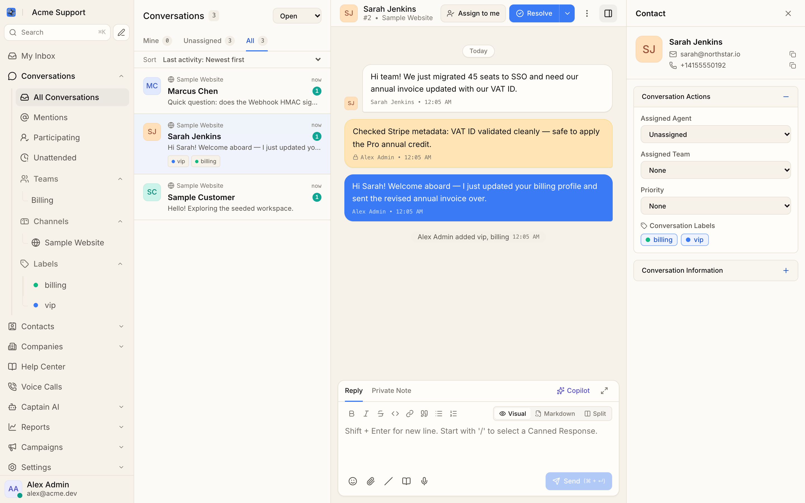

<div align="center">


# Pulsar

<p>
  <strong>Single-binary customer support platform — Rust + React Router rewrite of Chatwoot.</strong><br>
  Drop-in PostgreSQL 4.20 compatibility with zero Redis, zero Sidekiq, and ~19 MB RAM.
</p>

<p>
  <a href="https://github.com/aphelion31/pulsar/actions/workflows/ci.yml"></a>
  <a href="https://github.com/aphelion31/pulsar/releases/latest"></a>
  <a href="https://github.com/aphelion31/pulsar/commits/develop"></a><!-- stars-badge:start --><!-- stars-badge:end -->
  <a href="Cargo.toml"></a>
  <a href="web/package.json"></a>
  <a href="LICENSE"></a>
</p>

</div>

<div align="center">

  <a href="https://github.com/aphelion31/pulsar/releases/download/readme-assets/pulsar-showcase.mp4">
    
  </a>

  <p><em>Pulsar workspace tour — click to watch the full HD MP4</em></p>

</div>

> **Note:** Pulsar replaces Chatwoot's Ruby on Rails + Sidekiq + Redis stack with one compiled Rust server (Axum + `sqlx`) and a React Router SPA while preserving Chatwoot's PostgreSQL schema and API shapes so existing databases, `/sdk.js` widgets, and API clients keep working. Chatwoot is © Chatwoot Inc., MIT licensed (see [`LICENSE-CHATWOOT`](LICENSE-CHATWOOT)). Pulsar is not affiliated with Chatwoot Inc.

---

<div align="center">

## Quick Start

</div>

### Docker Compose

Runs `nginx` (with `/cable` WebSocket upgrades) + `pulsar` (`axum`) + `pgvector/pgvector:pg17`:

```bash
cp .env.example .env
# Set SECRET_KEY_BASE and POSTGRES_PASSWORD in .env for production
docker compose up -d --build

# Optional: seed an admin account (or complete onboarding at http://localhost:8080/app/installation/onboarding)
docker compose exec axum pulsar seed admin@your-domain 'change-me-now' "Your company"
```

### From Source

Requires PostgreSQL with `pgvector`. Nothing else.

```bash
# 1. Database & migrations
createdb pulsar
for f in migrations/*.sql; do psql -d pulsar -v ON_ERROR_STOP=1 -f "$f"; done

# 2. Build the frontend once (served by the binary at /app)
(cd web && bun install --frozen-lockfile && bun run build)

# 3. Seed first admin user, account, and API inbox
cargo run --release -- seed admin@example.com 'change-me-now' Acme

# 4. Serve
SECRET_KEY_BASE=$(openssl rand -hex 64) cargo run --release   # http://localhost:3000/app/login
```

| Env | Default | Purpose |
| --- | --- | --- |
| `DATABASE_URL` | `postgres://localhost/pulsar` | Postgres connection |
| `BIND` | `0.0.0.0:3000` | Listen address |
| `WEB_DIR` | `web/build/client` | Built React frontend |
| `STORAGE_DIR` | `./storage` | Uploaded files (ActiveStorage disk layout) |
| `SECRET_KEY_BASE` | dev value | Signs file URLs and widget tokens — **set and keep stable in production** |
| `FRONTEND_URL` | `http://localhost:3000` | Public base URL |

Put a TLS reverse proxy (Caddy, Traefik, nginx) in front and forward websocket upgrades on `/cable`. Embed live chat with `<script src="https://your-pulsar/sdk.js" data-website-token="..."></script>`. Full guide: [`docs/architectures/04.DEPLOY.md`](docs/architectures/04.DEPLOY.md).

**Existing Chatwoot 4.20 database:** point `DATABASE_URL` at a copy first, keep `STORAGE_DIR` aligned, and stop Chatwoot's Sidekiq before switching. New passwords and tokens use **Argon2id**; existing `bcrypt` hashes (`$2a$`/`$2b$`/`$2y$`) continue to verify and transparently upgrade to Argon2id on login.

---

<div align="center">

## Benchmarks

</div>

### Size and memory (Docker x86_64 vs Chatwoot v4.15.1)

Measured on the same machine and dataset (200 contacts, 200 conversations, 2,000 messages, shared PostgreSQL 16 `pgvector`, capped at 2 CPU and 2 GB, `ab -k -c 10 -n 1000`):

| | Chatwoot | Pulsar | Comparison |
| --- | --- | --- | --- |
| **Docker image** | 709 MB (2.84 GB on disk) | 9 MB binary + 0.5 MB web app | **~80× smaller** |
| **Processes** | Rails (Puma) + Sidekiq + Redis | 1 | **No Redis / Sidekiq** |
| **Memory, web after load** | 364 MB | 19 MB | **19× less** |
| **Memory, background jobs** | 591 MB (Sidekiq) | none needed | — |
| **Memory, Redis** | 17 MB | none needed | — |
| **Memory total** | **972 MB** | **19 MB** | **51× less** |
| **Ready to serve** | 27.9 s | 1.4 s | **20× faster** |

### Throughput and latency

| Endpoint | Chatwoot req/s | Pulsar req/s | Speedup | Chatwoot p50 / p95 | Pulsar p50 / p95 |
| --- | ---: | ---: | ---: | --- | --- |
| `GET /api/v1/profile` | 32 | 2,412 | **75×** | 311 / 365 ms | 3 / 5 ms |
| `GET /conversations/meta` | 44 | 2,089 | **48×** | 229 / 272 ms | 3 / 8 ms |
| `GET /contacts` | 21 | 421 | **20×** | 462 / 602 ms | 19 / 46 ms |
| `GET /conversations/{id}/messages` | 20 | 227 | **11×** | 498 / 624 ms | 39 / 63 ms |
| `GET /conversations` (25 per page) | 1.6 | 30 | **19×** | 5,017 / 7,829 ms | 317 / 366 ms |
| `POST /conversations/{id}/messages` | 17 | 191 | **11×** | 576 / 682 ms | 45 / 113 ms |

### Original vs Rewrite Size Comparison

Measured directly on the checked-out upstream Chatwoot tree vs Pulsar (`src/`, `web/`, and local `--release` build on macOS `arm64` + PostgreSQL 18):

| Dimension | Chatwoot (Original) | Pulsar (Rewrite) | Reduction / Ratio |
| --- | --- | --- | --- |
| **Backend source** | 3,722 files · 301,161 LOC (`.rb`/`.erb`/`.jbuilder`/`.rake`, `11.57 MB`) | 65 files · 48,298 LOC (`src/*.rs`, `1.71 MB`) | **6.2× fewer LOC** (-84%) |
| **Frontend source** | 2,541 files · 334,067 LOC (`app/javascript`, `10.16 MB`) | 155 files · 25,802 LOC (`web/app/*.ts,tsx,css`, `1.13 MB`) | **12.9× fewer LOC** (-92%) |
| **All code files** (excl. `.git`, deps, build/log/tmp) | 6,458 files · 657,392 LOC (`56.89 MB`) | 223 files · 74,139 LOC (`2.84 MB`) | **8.9× fewer LOC** (-89%) |
| **Clean source tree size** | `267.4 MiB` (`280.4 MB`) | `4.91 MiB` (`5.15 MB`) | **54× smaller** |
| **Checkout artifacts** | `1.1 GB` | `28.1 MiB` release binary + `4.1 MiB` `web/build/client` | Single binary + static SPA |
| **Direct dependencies** | 149 Ruby gems + 116 npm packages | 33 Rust crates + 13 npm packages | **5.8× fewer dependencies** |
| **Local RSS memory** (macOS `arm64` `--release`) | — (`972 MB` Linux Docker) | **15.1 MiB** idle · **50.0 MiB** active | ~**19×–64× lower** |

<details>
<summary>Breakdown of built Pulsar frontend assets (<code>web/build/client</code>)</summary>

- Total `web/build/client`: **31 MiB** (incl. 57 synced `i18n/` locale bundles)
  - JS & CSS bundles (`assets/`): **3.0 MiB**
  - Self-hosted Inter & InterDisplay fonts (`fonts/`): **1.3 MiB**
  - Woodcut SVG brand assets (`brand-assets/`): **1.2 MiB**
- Release executable (`target/release/pulsar`): **29,510,944 bytes** (`28.1 MiB`)
- Note: The Docker API benchmark above was recorded prior to full omni-channel, Captain AI, Help Center, and Inter webfont parity; current full-featured local `--release` footprint is **28.1 MiB** binary + **4.1 MiB** `web/build/client`, **15.1 MiB** idle / **50.0 MiB** active RSS on macOS `arm64`.

</details>

---

<div align="center">

## Screenshots

<table>
  <tr>
    <td align="center"><a href="docs/screenshots/conversations-light.png"></a><br>Conversations Inbox (Light · Cobalt &amp; Parchment)</td>
    <td align="center"><a href="docs/screenshots/conversations-dark.png"></a><br>Conversations Inbox (Dark · Obsidian)</td>
  </tr>
  <tr>
    <td align="center"><a href="docs/screenshots/reports-overview.png"></a><br>Live Reports Overview</td>
    <td align="center"><a href="docs/screenshots/reports-conversations.png"></a><br>Conversations Analytics</td>
  </tr>
  <tr>
    <td align="center"><a href="docs/screenshots/super-admin.png"></a><br>Super Admin Console</td>
    <td align="center"><a href="docs/screenshots/login.png"></a><br>Login &amp; SAML SSO</td>
  </tr>
</table>

<p>
  <a href="docs/screenshots/widget-home.png"></a><br>
  Embeddable Live Chat Widget
</p>

</div>

---

## Why Pulsar

- **Collaboration & Productivity:** 3-pane inbox, reply / private note tabs, Markdown composer, `/` canned responses, `@` mentions, emoji picker, Help Center article insert, audio notes, file attachments, labels, teams, capacity & assignment policies, custom roles, macros, automation rules, saved views, global search, and `⌘K` Command Bar.
- **Channels, AI & Self-Service:** Website live chat (`/sdk.js` + `/app/widget`), API inbox, Email (SMTP/IMAP), WhatsApp, Twilio, SMS (Bandwidth), Facebook, Instagram, Telegram, Line, Voice calls, multi-locale **Help Center Portals** (`/hc`), and **Captain AI** (`pgvector` document ingestion, FAQs, custom tools, reply Copilot).
- **Operations, Security & Analytics:** SLA policies & breach alerts, CSAT surveys, campaigns, HMAC webhooks, Agent Bots, Dashboard Apps, integrations (Linear, Shopify, Stripe, Dialogflow, Dyte), live overview & v2 reports, Public & Platform APIs, CSV imports/exports, audit logs, Argon2id + legacy bcrypt auth, 2FA MFA, SAML SSO, and **Super Admin Console** (`/app/super_admin`).
- **Single-node by default:** In-memory realtime pub/sub and presence, with Postgres `LISTEN/NOTIFY` multi-node fan-out supported.

---

## Documentation & Development

- [`docs/ARCHITECTURE.md`](docs/ARCHITECTURE.md) — backend, realtime, and frontend layout
- [`docs/architectures/`](docs/architectures/) — Chatwoot compatibility notes & deployment
- [`docs/PARITY-AUDIT-AND-TODO.md`](docs/PARITY-AUDIT-AND-TODO.md) — full feature parity audit
- [`AGENTS.md`](AGENTS.md) — contributor & agent guidelines

**Branching model:** [git-flow](https://nvie.com/posts/a-successful-git-branching-model/) with `develop` as the integration branch and `vX.Y.Z` tags on `master`. Work branches follow `PLR-<number>/<type>-<description>` via `scripts/new-branch.sh`. Install hooks once: `git config core.hooksPath .githooks`. Details: [`docs/github/01.GIT-COMMIT.md`](docs/github/01.GIT-COMMIT.md), [`02.GIT-BRANCH.md`](docs/github/02.GIT-BRANCH.md), [`03.GIT-PR-FLOW.md`](docs/github/03.GIT-PR-FLOW.md).

**Frontend development:** run the Rust binary, then `cd web && PULSAR_URL=http://127.0.0.1:3000 bun run dev` (Vite proxies `/api`, `/auth`, `/rails`, and `/cable`).

```bash
cargo test --offline --locked                         # Rust unit & router tests
BASE=http://127.0.0.1:3000 tools/smoke.sh             # API smoke test against a running server
BASE=http://127.0.0.1:3000 tools/chatwoot-issues.sh   # regression checks
(cd web && bun run typecheck && bun run build)        # frontend types + production bundle
```<!-- star-history:start --><!-- star-history:end -->

---

## Security & License

Found a vulnerability? Please report it privately via [GitHub security advisories](https://github.com/aphelion31/pulsar/security/advisories/new).

Thanks to everyone who [contributes](https://github.com/aphelion31/pulsar/graphs/contributors), and to the Chatwoot team and community. Pulsar is released under the MIT License (see [`LICENSE`](LICENSE)), including schema and API compatibility derived from Chatwoot (MIT, © Chatwoot Inc., see [`LICENSE-CHATWOOT`](LICENSE-CHATWOOT)). Chatwoot's `enterprise/` code is under a separate license and is not used.
