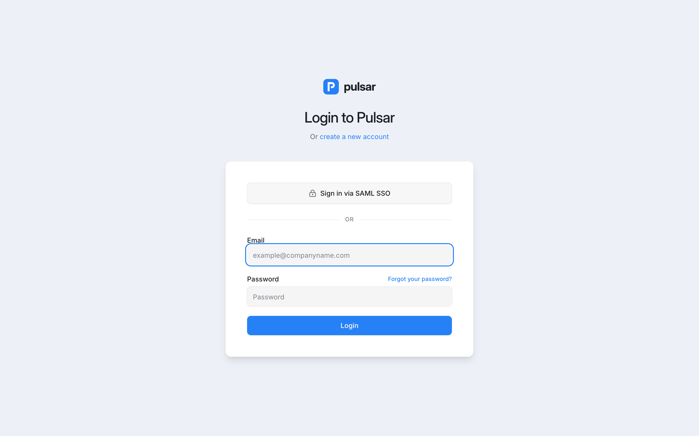
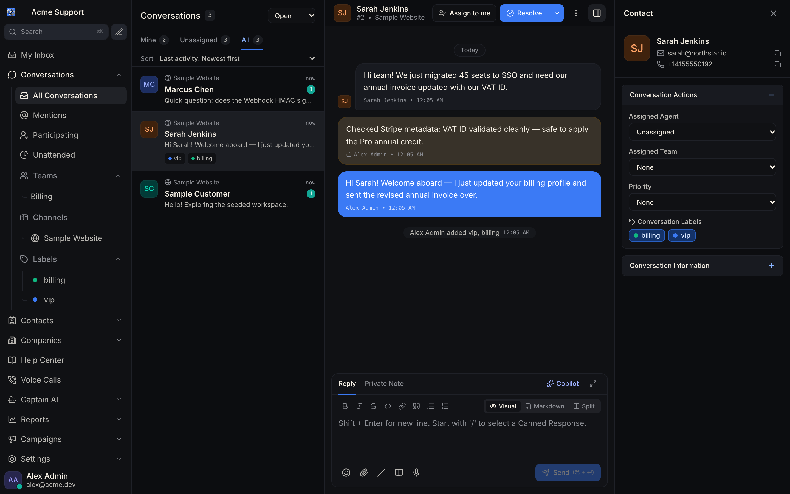
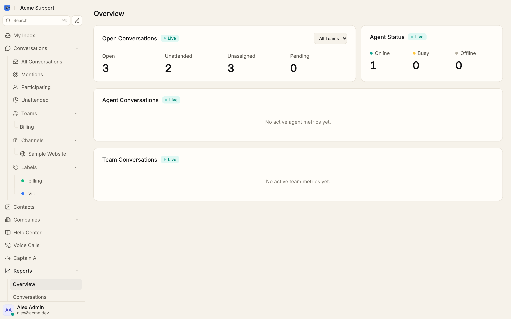
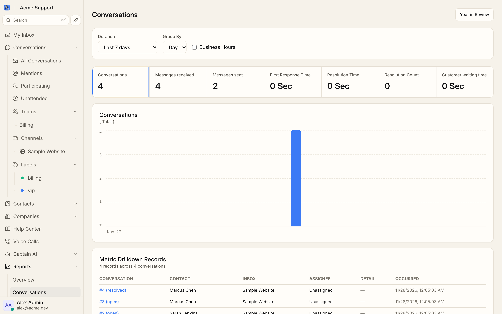
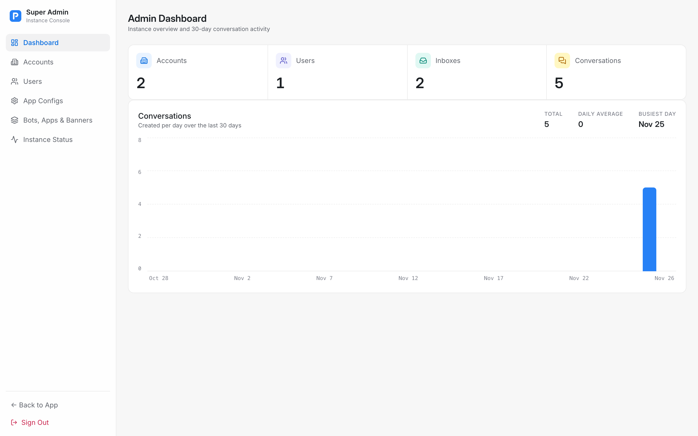
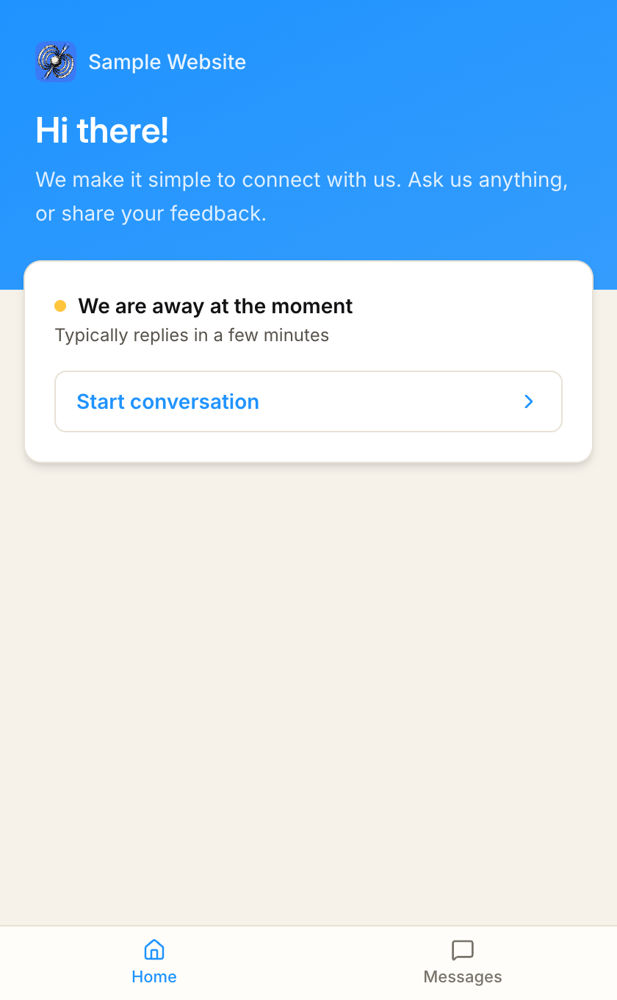

<p align="center">
  <picture>
    <source media="(prefers-color-scheme: dark)" srcset="web/public/brand-assets/logo_dark.svg">
    <source media="(prefers-color-scheme: light)" srcset="web/public/brand-assets/logo.svg">
    
  </picture>
</p>

<h3 align="center">The lightweight customer support platform — Rust + React Router rewrite of Chatwoot</h3>

<p align="center">
  <a href="https://github.com/aphelion31/pulsar/actions/workflows/ci.yml"></a>
  
  
  
  
</p>

> **Note:** Pulsar is a single-binary Rust rewrite of [Chatwoot](https://github.com/chatwoot/chatwoot). The Ruby on Rails + Sidekiq + Redis stack is replaced by one compiled Rust server (Axum + `sqlx`), and the Vue dashboard by a React Router SPA rebranded for Pulsar while preserving Chatwoot's PostgreSQL schema and API shapes so existing databases, SDK widgets and API clients keep working. Chatwoot is © Chatwoot Inc., MIT licensed (see `LICENSE-CHATWOOT`). Pulsar is not affiliated with Chatwoot Inc.

---

Pulsar runs as a single process with PostgreSQL (`pgvector`) as its only external dependency. You get a full omnichannel inbox, Help Center, Captain AI, automations, SLA tracking, Super Admin console and live chat widget at a fraction of the codebase size, dependency count and memory footprint.

### ⚡ Single binary, ~15–50 MB RAM locally

No Rails, no Sidekiq, no Redis. The HTTP API, background workers/scheduler, realtime ActionCable websocket and SPA frontend run out of one compiled binary (**28.1 MiB** release binary + **4.1 MiB** static `web/build/client` bundle on macOS `arm64`, using **15.1 MiB** RSS idle and **50.0 MiB** active).

### 💬 Shared inbox & omnichannel

Conversations in one 3-pane workspace: reply / private note tabs, Markdown composer, `/` canned responses, `@` mentions, emoji picker, Help Center article insert, audio notes, file attachments, labels, teams, priority, snooze/resolve, bulk actions and `⌘K` Command Bar with light and dark modes.

### 🔌 Drop-in for Chatwoot

Point Pulsar at a Chatwoot 4.19 PostgreSQL database and existing users keep their passwords and login tokens (`bcrypt`, `devise_token_auth`, MFA TOTP/backup codes and SAML SSO compatible). Account APIs (`/api/v1/accounts/...`), v2 reports, Public API, Platform API and `/sdk.js` live-chat widget follow Chatwoot's request and response shapes.

### 🗂️ Features

#### Collaboration & Productivity

- Private notes, canned responses, agent signatures, draft persistence and audio notes.
- Labels, teams, agent capacity/assignment policies, custom roles, macros and automation rules.
- Custom filters, saved custom views, global search and keyboard shortcuts (`?` / `⌘K`).

#### Channels, AI & Self-Service

- Website live chat widget (`/sdk.js` + `/app/widget`), API inbox, Email (SMTP/IMAP), WhatsApp, Twilio, SMS (Bandwidth), Facebook, Instagram, Telegram, Line and Voice calls.
- **Help Center Portals** with multi-locale categories, Markdown article editor and public portal routes (`/hc`).
- **Captain AI** assistants, document ingestion (`pgvector`), FAQ responses, custom tools and inbox reply Copilot.

#### Operations, Security & Analytics

- SLA policies and breach alerts, CSAT surveys, campaigns (ongoing / live chat / WhatsApp), webhooks with HMAC delivery, Agent Bots, Dashboard Apps and integrations (Linear, Shopify, Stripe, Dialogflow, Dyte).
- Live overview & historical v2 reports (conversations, agents, inboxes, labels, teams, CSAT, bot, SLA).
- **Super Admin console** (`/app/super_admin`), installation onboarding, CSV data imports/exports, audit logs, 2FA MFA and SAML SSO.

---

## UI Screenshots

All screenshots below were captured cleanly against the local `--release` Pulsar binary (`WEB_DIR=web/build/client`) connected to PostgreSQL 18 via headless Chromium (zero console errors, zero failed requests).

### Login (Light)



### Conversations Inbox (Light & Dark)

| Light Mode | Dark Mode |
| --- | --- |
|  |  |

### Reports (Live Overview & Conversations Analytics)

| Live Overview | Conversations Analytics |
| --- | --- |
|  |  |

### Super Admin Console & Website Chat Widget

| Super Admin Dashboard | Embeddable Live Chat Widget |
| --- | --- |
|  |  |

---

## Original vs Rewrite Size Comparison

Measured directly on the checked-out upstream Chatwoot tree vs Pulsar (`src/`, `web/` and local `--release` build on macOS `arm64` + PostgreSQL 18):

| Dimension | Chatwoot (Original) | Pulsar (Rewrite) | Reduction / Ratio |
| --- | --- | --- | --- |
| **Backend source** | 3,722 files · 301,161 LOC (`.rb`/`.erb`/`.jbuilder`/`.rake`, `11.57 MB`) | 65 files · 48,298 LOC (`src/*.rs`, `1.71 MB`) | **6.2x fewer LOC** (-84%) |
| **Frontend source** | 2,541 files · 334,067 LOC (`app/javascript`, `10.16 MB`) | 155 files · 25,802 LOC (`web/app/*.ts,tsx,css`, `1.13 MB`) | **12.9x fewer LOC** (-92%) |
| **All code files** (excl. `.git`, deps, build/log/tmp) | 6,458 files · 657,392 LOC (`56.89 MB` code) | 223 files · 74,139 LOC (`2.84 MB` code) | **8.9x fewer LOC** (-89%) |
| **Clean source tree size** (excl. `.git`, deps, build) | `267.4 MiB` (`280.4 MB`) | `4.91 MiB` (`5.15 MB`) | **54x smaller** |
| **Checkout on disk** (with `.git` & installed deps) | `1.1 GB` | `28.1 MiB` release binary + `4.1 MiB` `web/build/client` | Single binary + static SPA |
| **Direct dependencies** | 149 Ruby gems + 116 npm packages (79 + 37 dev) | 33 Rust crates + 13 npm packages (5 + 8 dev) | **5.8x fewer dependencies** |
| **Runtime processes** | Rails (Puma) + Sidekiq + Redis | 1 binary (`pulsar`) + PostgreSQL | **No Redis / Sidekiq** |
| **Local RSS memory** (macOS `arm64` `--release`) | — (see Linux Docker benchmark below: `972 MB` total) | **15.1 MiB** (`15,472 KiB`) idle · **50.0 MiB** (`51,232 KiB`) active | ~**19x–64x lower** |

<details>
<summary>Breakdown of built Pulsar frontend assets (<code>web/build/client</code>)</summary>

- Total `web/build/client`: **4.1 MiB** (`4,232 KiB`)
  - JS & CSS bundles (`assets/`): **2.9 MiB** (`2,932 KiB`)
  - Self-hosted Inter & InterDisplay fonts (`fonts/`): **1.3 MiB** (`1,280 KiB`)
  - Custom geometric SVG brand assets (`brand-assets/`): **12 KiB**
- Release executable (`target/release/pulsar`): **29,510,944 bytes** (`28.1 MiB`)

</details>

---

## Benchmark

Previous Linux x86_64 Docker API benchmark: Chatwoot `v4.15.1` (official Docker image, Puma default, `ENABLE_RACK_ATTACK=false`) vs Pulsar on the **same machine and same data**: 200 contacts, 200 conversations, 2,000 messages, shared PostgreSQL 16 (`pgvector`), capped at 2 CPU and 2 GB (`ab -k -c 10 -n 1000`):

### Size and memory (Docker x86_64, v4.15.1 benchmark)

| | Chatwoot | Pulsar | |
| --- | --- | --- | --- |
| Docker image | 709 MB (2.84 GB on disk) | 9 MB binary + 0.5 MB web app | **~80x smaller** |
| Processes to run | Rails + Sidekiq + Redis | 1 | |
| Memory, web after load | 364 MB | 19 MB | **19x less** |
| Memory, background jobs | 591 MB (Sidekiq) | none needed | |
| Memory, Redis | 17 MB | none needed | |
| **Memory total** | **972 MB** | **19 MB** | **51x less** |
| Ready to serve after start | 27.9 s | 1.4 s | **20x faster** |

### Throughput and latency

| Endpoint | Chatwoot req/s | Pulsar req/s | Speedup | Chatwoot p50 / p95 | Pulsar p50 / p95 |
| --- | ---: | ---: | ---: | --- | --- |
| `GET /api/v1/profile` | 32 | 2,412 | **75x** | 311 / 365 ms | 3 / 5 ms |
| `GET /conversations/meta` | 44 | 2,089 | **48x** | 229 / 272 ms | 3 / 8 ms |
| `GET /contacts` | 21 | 421 | **20x** | 462 / 602 ms | 19 / 46 ms |
| `GET /conversations/{id}/messages` | 20 | 227 | **11x** | 498 / 624 ms | 39 / 63 ms |
| `GET /conversations` (25 per page) | 1.6 | 30 | **19x** | 5,017 / 7,829 ms | 317 / 366 ms |
| `POST /conversations/{id}/messages` | 17 | 191 | **11x** | 576 / 682 ms | 45 / 113 ms |

Read these numbers fairly:

- Both apps returned the same records with the same fields and zero failed requests on the same database.
- Note the Docker API benchmark above was recorded before feature-complete omni-channel, Captain AI, Help Center and Inter webfont parity were added; current full-featured local `--release` footprint is **28.1 MiB** binary + **4.1 MiB** `web/build/client`, **15.1 MiB** idle / **50.0 MiB** active RSS on macOS `arm64`.
- Chatwoot was measured with default Puma settings (1 process, 5 threads).

## Documentation

- [`docs/ARCHITECTURE.md`](docs/ARCHITECTURE.md): how the backend, realtime and frontend fit together.
- [`docs/architectures/`](docs/architectures/): structure, Chatwoot compatibility notes and deployment.
- [`docs/PARITY-AUDIT-AND-TODO.md`](docs/PARITY-AUDIT-AND-TODO.md): full feature conversion audit (Rust backend + React Router frontend) and prioritized TODO backlog.
- [`AGENTS.md`](AGENTS.md): working rules for contributors and coding agents.

## Branching model

We use the [git-flow](https://nvie.com/posts/a-successful-git-branching-model/) branching model.
The base branch is `develop`. Stable releases are tagged `vX.Y.Z` on `master`.

Work branches are `PLR-<number>/<type>-<description>`, for example `PLR-001/feat-boilerplate`. Create one with
`scripts/new-branch.sh feat-<description>`. Commits and PR titles are Conventional Commits in English. PRs go into
`develop` and are squash merged. Install the hooks once: `git config core.hooksPath .githooks`.

Details: [commit](docs/github/01.GIT-COMMIT.md), [branch](docs/github/02.GIT-BRANCH.md),
[pull request and release](docs/github/03.GIT-PR-FLOW.md).

## Deployment

You need PostgreSQL with the `pgvector` extension. Nothing else.

```bash
# 1. Database & migrations
createdb pulsar
for f in migrations/*.sql; do psql -d pulsar -v ON_ERROR_STOP=1 -f "$f"; done

# 2. Build the frontend once (served by the binary at /app)
(cd web && bun install --frozen-lockfile && bun run build)

# 3. First admin user, account and API inbox (or use /app/installation/onboarding in the browser)
cargo run --release -- seed admin@example.com 'change-me-now' Acme

# 4. Serve
SECRET_KEY_BASE=$(openssl rand -hex 64) cargo run --release   # http://localhost:3000/app/login
```

| Env | Default | Purpose |
| --- | --- | --- |
| `DATABASE_URL` | `postgres://localhost/pulsar` | Postgres connection |
| `BIND` | `0.0.0.0:3000` | Listen address |
| `WEB_DIR` | `web/build/client` | Built React frontend |
| `STORAGE_DIR` | `./storage` | Uploaded files (same layout as Rails ActiveStorage disk service) |
| `SECRET_KEY_BASE` | dev value | Signs file URLs and widget tokens. **Set it in production** and keep it stable |
| `FRONTEND_URL` | `http://localhost:3000` | Public base URL |

Put a TLS reverse proxy (Caddy, Traefik, nginx) in front and pass websocket upgrades on `/cable`.
Embed the live chat on a website with `<script src="https://your-pulsar/sdk.js" data-website-token="..."></script>`.
More in [docs/architectures/04.DEPLOY.md](docs/architectures/04.DEPLOY.md).

### Existing Chatwoot database

Pulsar targets the Chatwoot 4.19 schema and logs a warning on start if the database is older. Upgrade Chatwoot
first, test on a copy, and stop Chatwoot's Sidekiq before switching so two systems do not process the same data.

### Frontend development

Run the binary, then `cd web && PULSAR_URL=http://127.0.0.1:3000 bun run dev`. Vite proxies `/api`, `/auth`, `/rails`
and the `/cable` websocket to the binary.

## Scope

**Ported:** auth (`devise_token_auth` compatible, MFA/TOTP & backup codes, SAML SSO, registration & password reset),
profile, accounts, realtime websocket (`/cable`), conversations, messages, drafts, attachments & avatars, contacts,
companies, all channels (Website Widget `/sdk.js`, API, Email IMAP/SMTP, WhatsApp, Twilio, SMS/Bandwidth, Facebook,
Instagram, Telegram, Line, Voice/Calls), Help Center portals/categories/articles (`/hc`), Captain AI (assistants,
documents, FAQs, tools & Copilot), SLA policies, CSAT surveys, campaigns, automation rules, webhooks (with HMAC delivery),
agent bots, dashboard apps, integrations (Linear, Shopify, Stripe, Dialogflow, Dyte), audit logs, custom roles,
custom attributes, custom filters & views, assignment & capacity policies, v2 reports, Public & Platform APIs,
CSV imports/exports, installation onboarding, and Super Admin console (`/app/super_admin`).

**Single node only:** realtime pub/sub and presence are in memory. Add Redis or Postgres `LISTEN/NOTIFY` fan-out
before running more than one instance.

## Tests

```bash
cargo test --offline --locked                         # Rust unit & router tests
BASE=http://127.0.0.1:3000 tools/smoke.sh             # API smoke test against a running server
BASE=http://127.0.0.1:3000 tools/chatwoot-issues.sh   # regression checks
(cd web && bun run typecheck && bun run build)              # frontend types + production bundle
```

## Security

Found a vulnerability? Please do not open a public issue. Report it privately through
[GitHub security advisories](https://github.com/aphelion31/pulsar/security/advisories/new).

## Contributors

Thanks goes to everyone who [contributes](https://github.com/aphelion31/pulsar/graphs/contributors), and to the
Chatwoot team and community, whose product, schema and API Pulsar is built on.

*Pulsar* is released under the MIT License (see `LICENSE`). It includes schema and API compatibility derived from
Chatwoot (MIT, © Chatwoot Inc., see `LICENSE-CHATWOOT`). Chatwoot's `enterprise/` code is under a separate license
and is not used.
